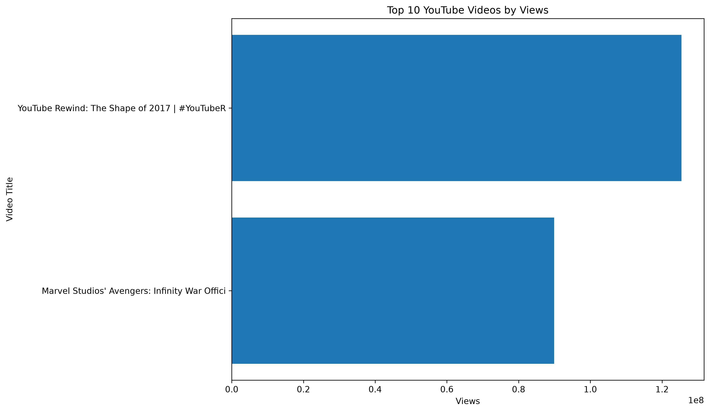
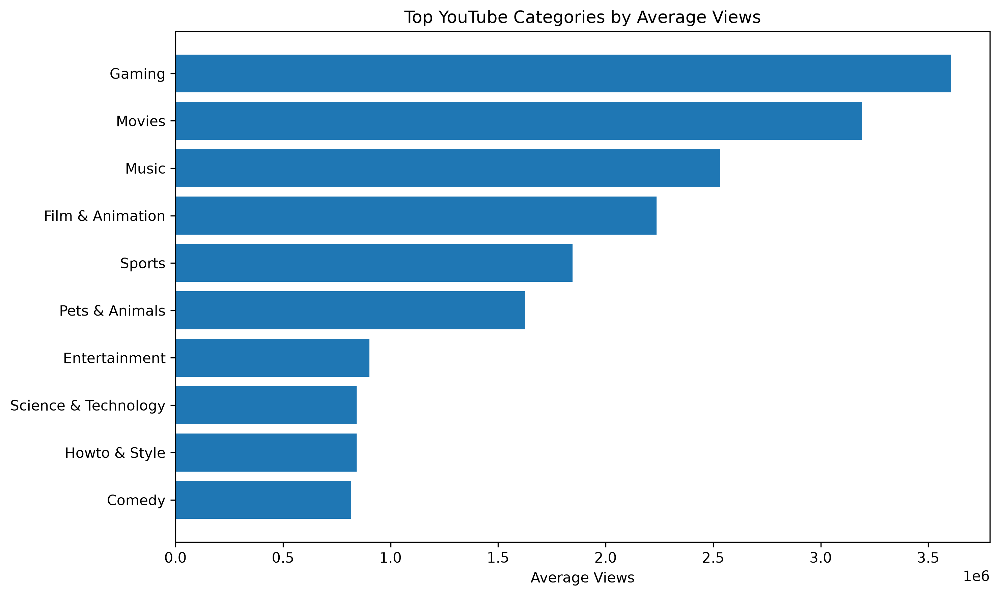

# YouTube Data Analytics Project

## Project Overview
This project explores YouTube trending video data using Python, Pandas, and Matplotlib. It focuses on video performance, engagement patterns, and category-wise comparisons.

## Objectives
- Explore and clean YouTube video data.
- Identify the top 10 video records by views.
- Analyze relationships between views, likes, and comments.
- Calculate view-based like and comment rates.
- Compare average views across YouTube categories.

## Tools and Technologies
- Python
- Pandas
- Matplotlib
- Jupyter Notebook

## Project Structure
- `data/` — input dataset (download separately if not included)
- `notebooks/` — analysis notebook
- `charts/` — exported visualizations
- `requirements.txt` — Python dependencies

## How to Run
1. Install Python.
2. Install dependencies using `pip install -r requirements.txt`.
3. Download the dataset and place the India CSV file in the `data/` folder.
4. Open `notebooks/youtube_analysis.ipynb` in Jupyter Notebook.
5. Run the notebook cells in order.

## Analysis Performed
- Dataset inspection and data-quality checks
- Duplicate and missing-value analysis
- Top 10 video records by views
- Views, likes, and comments correlation
- View-based like and comment rates
- Category-wise average views

## Data Notes
The dataset contains historical trending-video records. A video may appear on multiple dates, so record counts and summed views do not necessarily represent unique videos or unique lifetime views. Correlation does not imply causation.

## Findings
Most-viewed record:
Title: YouTube Rewind: The Shape of 2017 | #YouTubeRewind
Views: 125,432,237
Likes: 2,912,710
Comments: 807,558
Total records: 33089
Unique videos: 16307
Total views: 32,967,977,200
Average views: 996,342.51
Average likes: 25,587.62
Average comments: 2,524.78

## Visualizations

